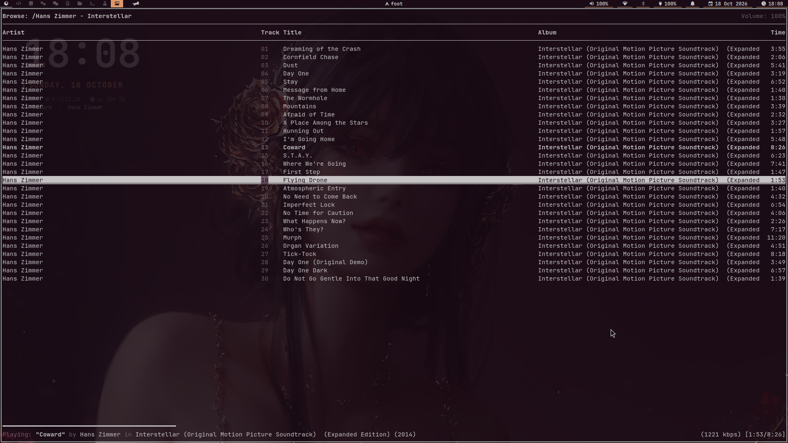
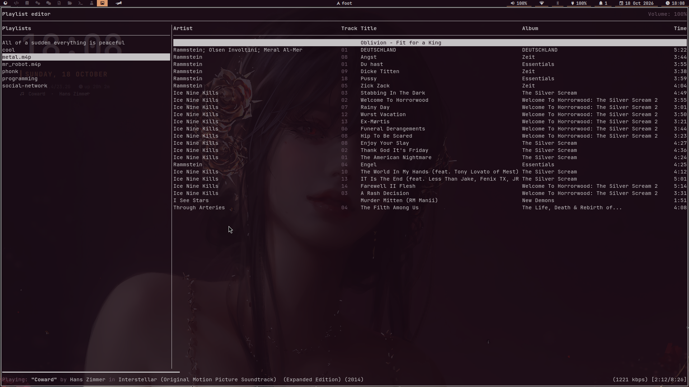
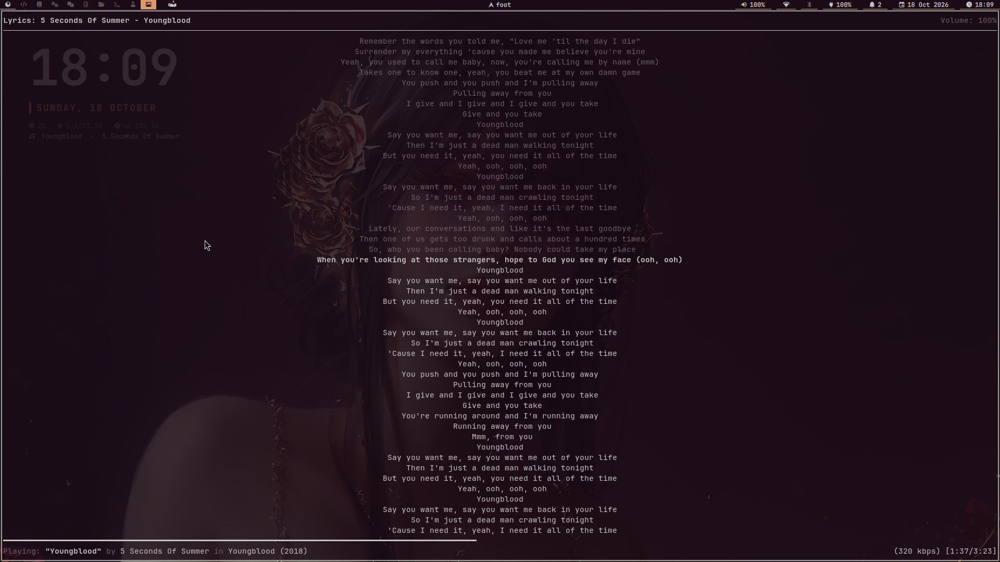

# rmptui


[](https://github.com/krolyxon/rmptui/releases)

**A fast, keyboard-driven MPD client for your terminal.**

rmptui is a terminal interface for [Music Player Daemon
(MPD)](https://www.musicpd.org/) that looks and feels like ncmpcpp. Browse your
library, manage the queue and playlists, edit tags, read synced lyrics and
watch a music visualizer without leaving the terminal.



<table>
  <tr>
    <td width="50%"><br>
      <sub><b>Playlist Editor</b> · Manage your playlists</sub></td>
    <td width="50%"><br>
      <sub><b>Lyrics Screen</b> · Fetched lyrics with synchronization</sub></td>
  </tr>
</table>

## Screens

| Key | Screen | What it does |
| --- | --- | --- |
| `1` | **Playlist** | The play queue as a table (Artist, Track, Title, Album, Time). Play, remove, reorder, mark, shuffle or save it as a playlist. `L` shows a synced lyrics pane next to it. |
| `2` | **Browse** | Your music folders. Folders (`[name]`) span the whole row, songs use the same columns as the queue, and stored playlists are listed at the bottom of the root folder. |
| `3` | **Playlist editor** | Stored playlists and their songs: load, play from a song, remove or reorder songs, rename or delete playlists. |
| `4` | **Media library** | Album artists → albums (with year) → songs. `t` switches between AlbumArtist and Artist. |
| `5` | **Tag editor** | Directories, tag types and tags, like ncmpcpp: edit Title, Artist, Album Artist, Album, Date, Track, Genre, Composer, Performer, Disc and Comment of one or many songs, rename files, fix letter case, then save. |
| `6` | **Music visualizer** | ncmpcpp-style wave, filled wave, spectrum and ellipse visualizers fed by an MPD fifo output; `Space` cycles them. |
| `7` | **Lyrics** | Synced lyrics that follow playback, or plain lyrics you can scroll. |

Every screen shares ncmpcpp's frame: the screen title and volume on top
(active modes such as `[rz]` appear on the line below), and at the bottom a
progress bar above `Playing: "Title" by Artist in Album (Year)` with the
bitrate and elapsed/total time.

Other highlights:

- **Instant controls.** All MPD traffic runs in background tasks over MPD's
  `idle` notifications, so seeking, volume changes and skipping never wait for
  the UI, and the UI never waits for the server.
- **Search everywhere.** `/` searches the focused list with a
  case-insensitive regex, like ncmpcpp; `n`/`N` cycle through the matches.
- **Marks.** `v` marks items; queue removal, add-to-playlist and tag edits
  then apply to every marked item.
- **Mouse support.** Click to select, double-click to play/open, scroll with
  the wheel and click the progress bar to seek.
- **TCP or Unix socket**, with password support and automatic reconnection.

## Requirements

- A running MPD server with its music library configured.
- Rust 1.88 or newer and Cargo to build from source.

## Install

Prebuilt binaries for Linux (x86_64 and aarch64, glibc and static musl) and
macOS are attached to each [release](https://github.com/krolyxon/rmptui/releases).
To download and install the right one for your machine:

```sh
curl --proto '=https' --tlsv1.2 -LsSf https://github.com/krolyxon/rmptui/releases/latest/download/rmptui-installer.sh | sh
```

To build and install from a local checkout instead, run the installer to build the release executable and
copy it to `/usr/local/bin/rmptui`:

```sh
./install.sh
```

The script uses `sudo` for the system-directory operations when needed. To use
a different binary directory or uninstall rmptui:

```sh
./install.sh --bin-dir "$HOME/.local/bin"
./install.sh --uninstall
```

Uninstall from a custom directory with
`./install.sh --uninstall --bin-dir "$HOME/.local/bin"`. Run
`./install.sh --help` for usage.

## Build from source

```sh
git clone https://github.com/krolyxon/rmptui.git
cd rmptui
cargo run --release
```

## Configuration

On first launch rmptui writes a fully commented configuration to
`$CONFIG_HOME/rmptui/config.toml`. If `CONFIG_HOME` is not set, it uses
`$XDG_CONFIG_HOME/rmptui/config.toml`, then `~/.config/rmptui/config.toml`.
Use `rmptui --config FILE` to load a different file, and
`rmptui --print-default-config` to see every option with its default. Restart
rmptui to apply changes.

You only need to keep the settings you change: anything left out keeps its
default, table by table. Unknown options and conflicting key bindings are
reported with the file and the offending value.

> **Upgrading from 0.1:** the configuration format changed. rmptui refuses to
> start with a 0.1 file and tells you so; move the old file aside, start
> rmptui to generate the new one, and copy your MPD settings over.

The main sections:

```toml
[mpd]
host = "127.0.0.1"      # or a Unix socket path such as "~/.config/mpd/socket"
port = 6600
password = ""
music_directory = ""    # for the tag editor and local .lrc files (see below)

[playback]
seek_seconds = 5
volume_step = 5

[ui]
startup_screen = "queue"
mouse = true
confirm_clear_queue = false
lyrics_pane = false
song_columns = [        # queue, browser and playlist editor
    { field = "artist", width = 34 },
    { field = "track", width = 5 },
    { field = "title", width = 33 },
    { field = "album", width = 30 },
    { field = "duration", width = 5 },
]

[theme]                 # color names, 256-color indices or "#rrggbb"
text = "reset"
dim = "darkgray"
selection_fg = "reset"  # both "reset": reverse video, like ncmpcpp
selection_bg = "reset"
visualizer = ["blue", "cyan", "green", "yellow", "red"]

[lyrics]
online = true           # look up lyrics on lrclib.net
cache = true

[visualizer]
fifo = "/tmp/mpd.fifo"
```

The MPD connection can also be set with environment variables, which take
precedence over the file:

| Variable | Description |
| --- | --- |
| `MPD_HOST` | Hostname, address or Unix socket path. Use `password@host` to set both host and password. |
| `MPD_PORT` | Port; an explicit port in `MPD_HOST` takes precedence. |

```sh
MPD_HOST=192.168.1.20 MPD_PORT=6600 rmptui
MPD_HOST='secret@localhost' rmptui
MPD_HOST=~/.config/mpd/socket rmptui
```

Logs (and panic details) are appended to `/tmp/rmptui.log`. Set
`RMPTUI_LOG=debug` for more detail.

### Visualizer

The visualizer reads raw audio from an MPD fifo output. Add this to
`mpd.conf` and restart MPD:

```
audio_output {
    type   "fifo"
    name   "Visualizer feed"
    path   "/tmp/mpd.fifo"
    format "44100:16:2"
}
```

`[visualizer]` must match the `path` and `format`. The fifo is only read while
the Visualizer screen is visible.

Like ncmpcpp, there are four styles: `wave` (the default), `wave_filled`,
`spectrum` and `ellipse`. Set the startup one with `style` and press `Space` on
the screen to cycle through them. With `stereo = true` the wave styles draw the
left channel in the top half and the right channel in the bottom half.

### Lyrics

Lyrics are looked up in this order:

1. An `.lrc` file next to the song (`Song.flac` → `Song.lrc`), when the music
   directory is known.
2. The cache in `$XDG_CACHE_HOME/rmptui/lyrics` (`~/.cache` by default).
3. [LRCLIB](https://lrclib.net), a free lyrics database. Results are cached.

Set `lyrics.online = false` to stay offline. `F5` on the Lyrics screen fetches
the lyrics of the current song again.

### Tag editor

MPD cannot change tags, so the tag editor writes the files directly, which
requires the music files to be on this machine. rmptui finds the music
directory in this order: `mpd.music_directory` in its config, MPD itself (only
answered over a Unix socket), and finally `music_directory` from the local
MPD's `mpd.conf` (`$XDG_CONFIG_HOME/mpd/mpd.conf`, `~/.config/mpd/mpd.conf`,
`~/.mpdconf`, `~/.mpd/mpd.conf` or `/etc/mpd.conf`) when MPD runs on this
machine.

Highlight a directory to see its songs in the `Tags` column, which shows the
tag selected in `Tag types`. `Enter` on a tag type edits it for all marked
songs (or all songs), `Enter` on a song edits it for that song only, and
`Filename` renames files. Changes stay pending until you choose `Save` (or
press `w`); `Reset` (or `u`) discards them. After saving, rmptui asks MPD to
rescan the folder.

## Key bindings

These are the defaults; every binding is configurable in the `[keys.*]` tables
of the config. `?` shows the active bindings inside rmptui.

Bindings are grouped by context. A key is looked up in the focused popup or
screen first, then in `navigation`, then in `global`, so screen bindings
shadow global ones on that screen (for example `R` renames a playlist on the
Playlists screen and toggles consume elsewhere).

### Global

| Key | Action |
| --- | --- |
| `1`–`7` | Switch screen |
| `Tab` / `Shift+Tab` | Next / previous screen |
| `p` | Toggle play/pause |
| `s` / `x` | Pause / stop |
| `>` / `<` | Next / previous track |
| `f` / `b` | Seek forward / backward |
| `+` `=` / `-` | Volume up / down |
| `m` | Toggle mute |
| `r` `z` `y` `R` | Toggle repeat, random, single, consume |
| `c` | Clear the queue |
| `U` | Rescan the music database |
| `?` `F1` | Show key bindings |
| `q` `Ctrl+c` | Quit |

### Lists

| Key | Action |
| --- | --- |
| `j` `k` / arrows | Move down / up |
| `g` `G` / `Home` `End` | Top / bottom |
| `Ctrl+d` `Ctrl+u`, `PageDown` `PageUp` | Half page / page |
| `h` `l` / arrows | Back or previous column / open or next column |
| `Enter` | Play or open the selected item |
| `Space` | Add to the queue (toggles songs in the browser) |
| `a` | Add to the queue, a new playlist or an existing one |
| `v` / `V` | Mark item / clear marks |
| `/`, `n` / `N` | Search, next / previous match |

### Screens

| Screen | Key | Action |
| --- | --- | --- |
| Queue | `d` `Delete` | Remove the song (or all marked songs) |
| Queue | `J` / `K` | Move the song down / up |
| Queue | `Z` / `S` | Shuffle / save as playlist |
| Queue | `o` | Jump to the playing song |
| Queue | `L` | Toggle the lyrics pane |
| Playlists | `d`, `J` / `K` | Remove / move the selected song |
| Playlists | `R` / `D` | Rename / delete the playlist |
| Library | `t` | Switch between AlbumArtist and Artist |
| Tags | `Enter` | Edit a tag, rename a file, or run the highlighted action |
| Tags | `w` / `u` | Write / discard pending changes |
| Lyrics | `F5` | Fetch lyrics again |

In text fields, `Enter` submits, `Esc` cancels, `Ctrl+w` deletes a word and
`Ctrl+a` / `Ctrl+e` jump to the start / end.

## License

rmptui is distributed under the
[GNU Affero General Public License v3.0](LICENSE).
